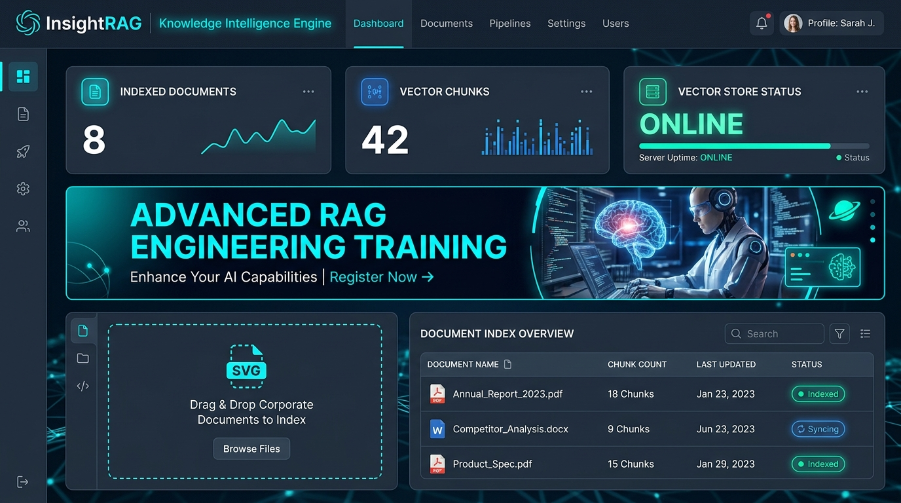
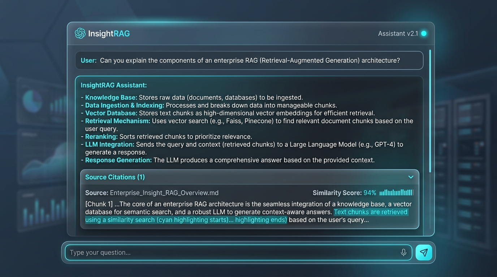
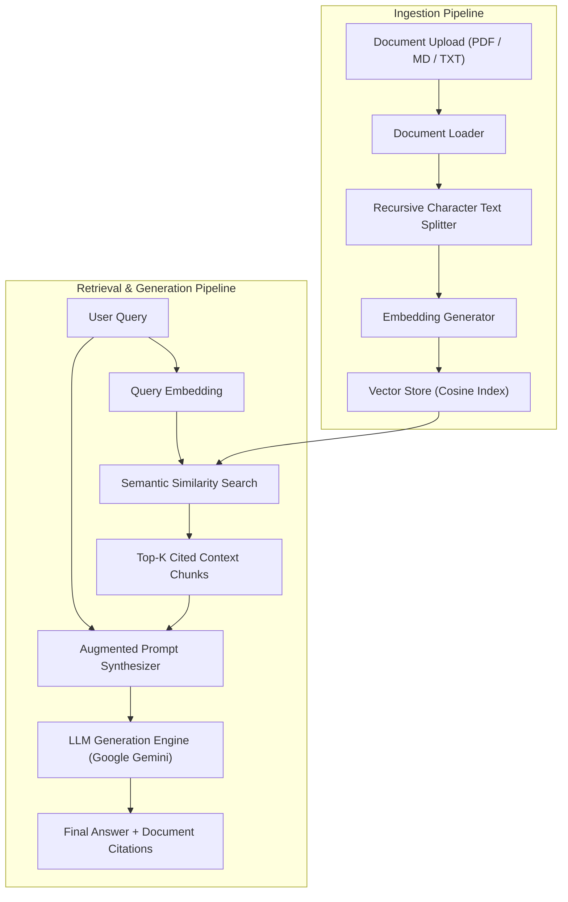

# 🔍 InsightRAG: Enterprise Knowledge Intelligence & RAG Platform

[](https://fastapi.tiangolo.com)
[](https://reactjs.org)
[](https://python.org)
[](https://vitejs.dev)
[](https://opensource.org/licenses/MIT)

**InsightRAG** is an enterprise-grade Retrieval-Augmented Generation (RAG) platform designed to index corporate knowledge bases, eliminate LLM hallucinations, and provide citation-backed conversational answers over multi-format documentation.

---

## 🌟 Key Features

- 📑 **Multi-Format Document Ingestion**: Upload and parse PDF, Markdown, Plaintext, Code, and JSON files seamlessly.
- ✂️ **Recursive Text Chunking**: High-precision splitting with configurable chunk size and overlap boundaries.
- 📐 **Vector Embeddings & Cosine Similarity**: Semantic vector representations with lightweight local indexing and high-speed similarity search.
- 🔍 **Citation-Backed Answering**: Every answer links directly to the source document and chunk snippet, ensuring verifiable provenance.
- 💬 **Interactive Chat Interface**: Clean, dark-mode conversational UI with streaming citations and latency tracking.
- 🐳 **Docker-Ready**: Launch complete frontend and backend services in seconds using `docker-compose.yml`.

---

## 📸 Screenshots Preview

| 🏠 Document Ingestion & Knowledge Hub | 💬 Citation-Backed Conversational RAG |
| :---: | :---: |
|  |  |

---

## 🏗️ System Architecture



---

## 📁 Repository Structure

```
InsightRAG/
│
├── backend/
│   ├── app/
│   │   ├── __init__.py
│   │   ├── main.py                     # FastAPI application entrypoint
│   │   │
│   │   ├── api/
│   │   │   ├── __init__.py
│   │   │   ├── chat.py                 # RAG query endpoints
│   │   │   └── documents.py            # Document upload & vector management
│   │   │
│   │   ├── core/
│   │   │   ├── config.py               # Application configuration
│   │   │   └── security.py             # Security utilities & sanitation
│   │   │
│   │   ├── rag/
│   │   │   ├── document_loader.py      # Multi-format document parser
│   │   │   ├── text_splitter.py        # Recursive character chunker
│   │   │   ├── embeddings.py           # Vector embedding generator
│   │   │   ├── vector_store.py         # Cosine similarity vector index
│   │   │   ├── retriever.py            # Top-k semantic retriever
│   │   │   └── rag_chain.py            # Context-augmented generation chain
│   │   │
│   │   ├── models/
│   │   │   └── schemas.py              # Pydantic models & validation
│   │   │
│   │   └── services/
│   │       ├── llm_service.py          # Google Gemini LLM provider
│   │       └── document_service.py     # Document management & vector storage
│   │
│   ├── requirements.txt
│   ├── .env.example
│   └── README.md
│
├── frontend/
│   ├── src/
│   │   ├── components/
│   │   │   ├── ChatBox.jsx             # Conversational stream & query input
│   │   │   ├── Message.jsx             # Message bubble with citations drawer
│   │   │   ├── FileUpload.jsx          # Drag-and-drop document uploader
│   │   │   └── Sidebar.jsx             # Navigation drawer & course links
│   │   │
│   │   ├── pages/
│   │   │   ├── Home.jsx                # Knowledge base dashboard & course banner
│   │   │   └── Chat.jsx                # Interactive RAG assistant
│   │   │
│   │   ├── services/
│   │   │   └── api.js                  # Axios client
│   │   │
│   │   ├── App.jsx                     # Layout & navigation routing
│   │   └── main.jsx
│   │
│   ├── package.json
│   └── README.md
│
├── data/
│   └── sample_documents/
│       ├── Enterprise_Insight_RAG_Overview.md
│       └── InsightRAG_Compliance_Security.txt
│
├── vectorstore/
│   └── .gitkeep
│
├── screenshots/
│   ├── home.png
│   └── chat.png
│
├── push_to_github.bat
├── .gitignore
├── README.md
├── LICENSE
└── docker-compose.yml
```

---

## 🚀 Quick Start Guide

### 1. Backend Setup

```bash
cd backend
python -m venv venv
venv\Scripts\activate   # On Windows
# or source venv/bin/activate on Linux/Mac

pip install -r requirements.txt
cp .env.example .env

uvicorn app.main:app --reload --port 8000
```
Interactive API documentation: `http://localhost:8000/docs`

---

### 2. Frontend Setup

```bash
cd frontend
npm install
npm run dev
```
Access the application at `http://localhost:5173`

---

## 📚 Advanced RAG Engineering Training Resources

If you are expanding your skills in building enterprise Retrieval-Augmented Generation (RAG) pipelines, advanced embeddings, and autonomous agentic workflows:

- 🎓 **[RAG Engineering Training Course in Delhi](https://uncodemy.com/course/rag-engineering-course-training-course-in-delhi)** — Comprehensive hands-on program in Delhi covering vector databases (ChromaDB, Pinecone, Milvus), LangChain, LlamaIndex, evaluation metrics, and production RAG agents.
- 🎓 **[RAG Engineering Training Course in Noida](https://uncodemy.com/course/rag-engineering-course-training-course-in-noida)** — Industry-aligned curriculum in Noida covering advanced semantic search, hybrid sparse/dense retrieval, multi-modal embeddings, and low-latency LLM deployments.

---

## 📄 License
This project is open-source under the [MIT License](LICENSE).
